# Скриншоты Hanafubuki

Оригиналы — `*.png`, лёгкие версии для сайта — `web/*.webp` (до 1600 px).

### Спавн: портал в Незер и вишнёвая арка в мир ресурсов
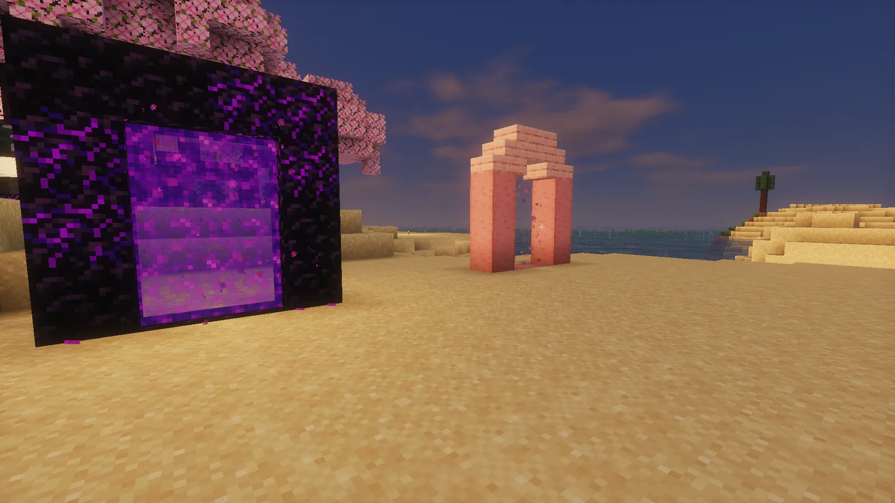
`https://raw.githubusercontent.com/Hanafubuki-minecraft/hanafubuki-brand/main/screenshots/web/01-spawn-portals.webp`

### Вид со спавна на мост
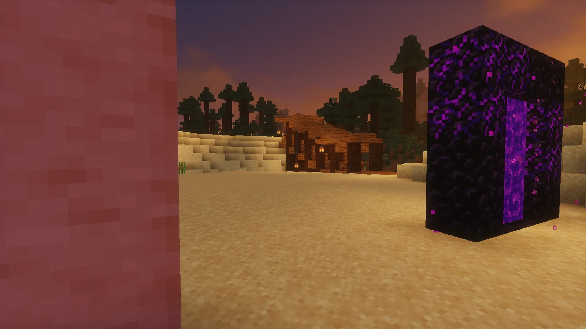
`https://raw.githubusercontent.com/Hanafubuki-minecraft/hanafubuki-brand/main/screenshots/web/02-spawn-view.webp`

### Мост на спавне
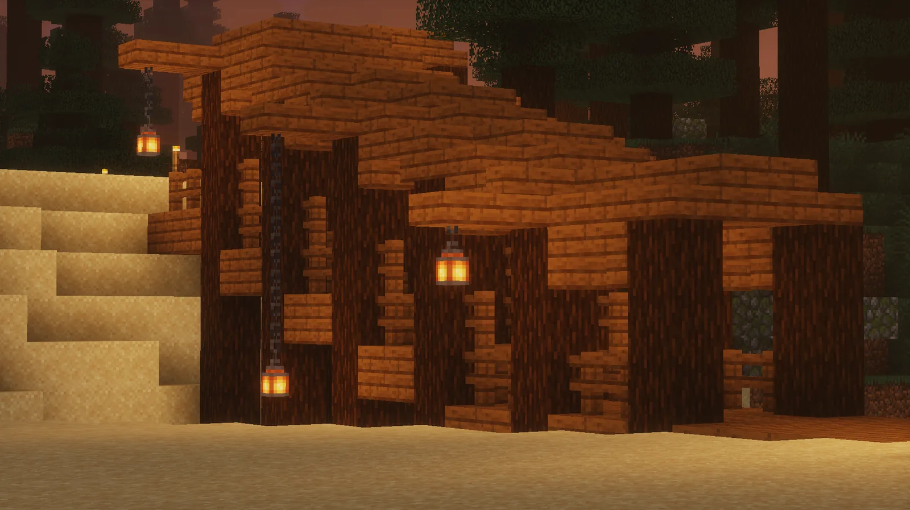
`https://raw.githubusercontent.com/Hanafubuki-minecraft/hanafubuki-brand/main/screenshots/web/03-storage-house.webp`

### Мой деревянный дом
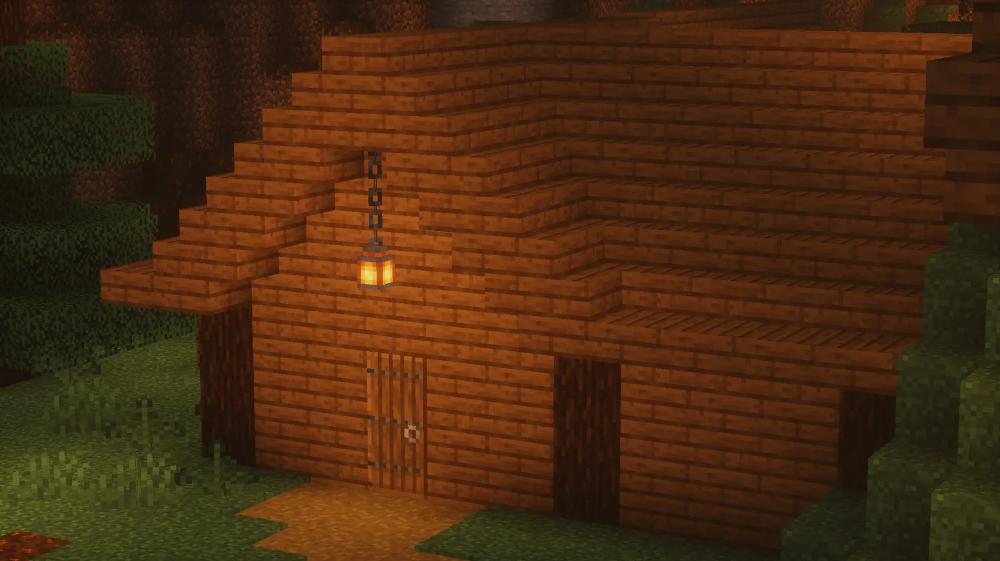
`https://raw.githubusercontent.com/Hanafubuki-minecraft/hanafubuki-brand/main/screenshots/web/04-wooden-house.webp`

### Склад в доме: длинный зал сундуков
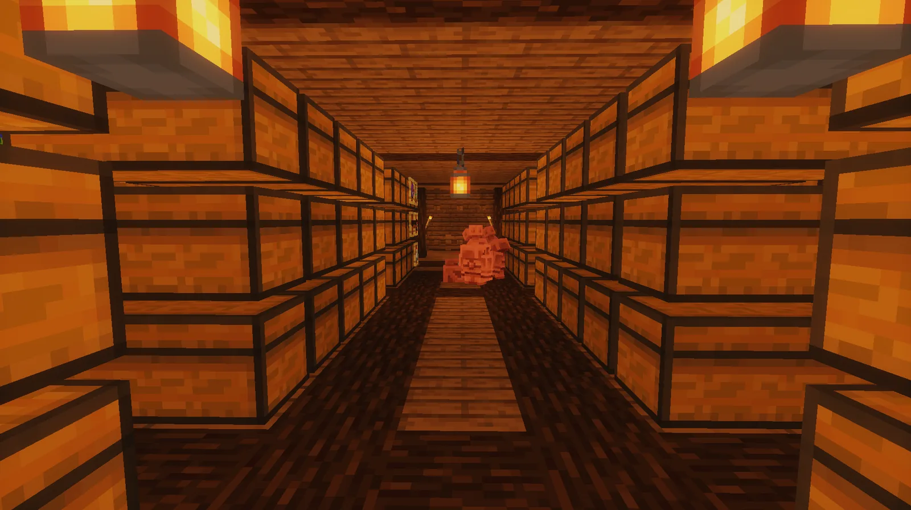
`https://raw.githubusercontent.com/Hanafubuki-minecraft/hanafubuki-brand/main/screenshots/web/05-storage-hall.webp`

### Вход в склад
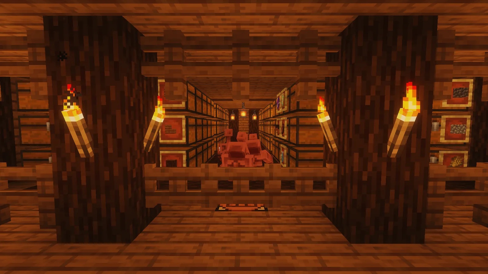
`https://raw.githubusercontent.com/Hanafubuki-minecraft/hanafubuki-brand/main/screenshots/web/06-storage-entrance.webp`

### Мастерская в доме: печи, наковальня, сундуки
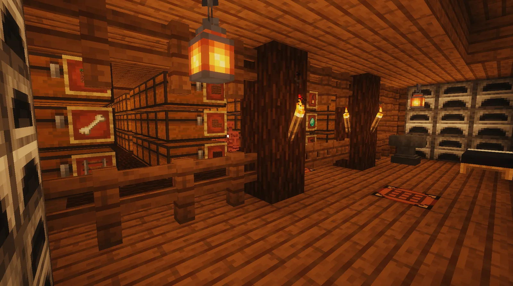
`https://raw.githubusercontent.com/Hanafubuki-minecraft/hanafubuki-brand/main/screenshots/web/07-workshop.webp`

### Мой дом ночью
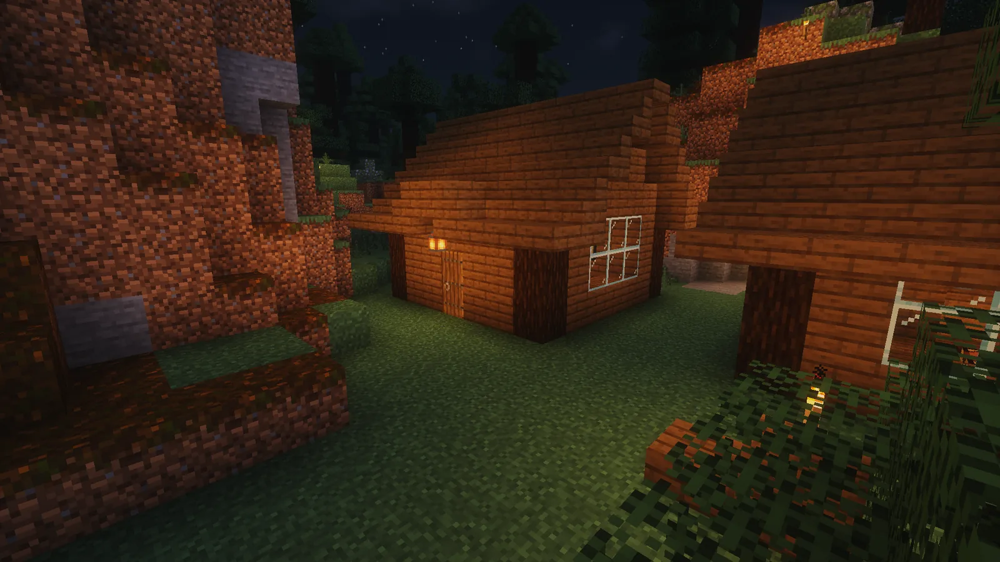
`https://raw.githubusercontent.com/Hanafubuki-minecraft/hanafubuki-brand/main/screenshots/web/08-village-night.webp`

### Карта: стройка сверху
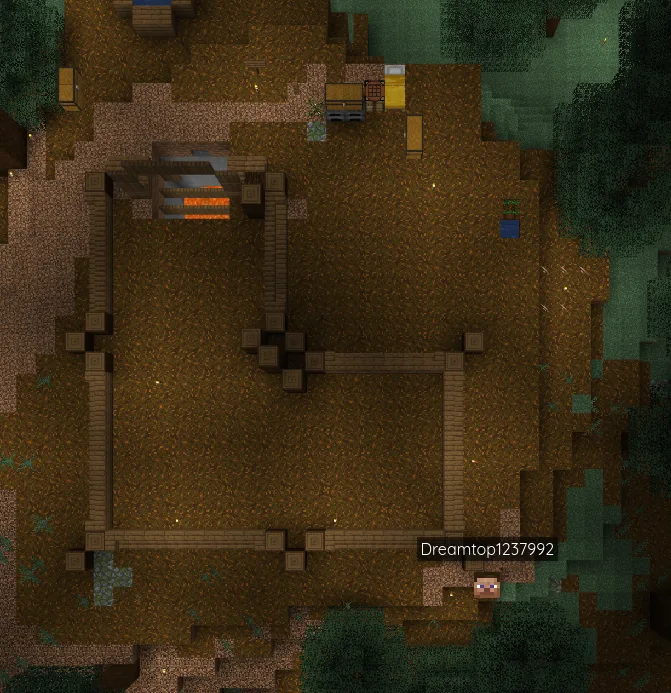
`https://raw.githubusercontent.com/Hanafubuki-minecraft/hanafubuki-brand/main/screenshots/web/09-map-build.webp`

### Карта: спавн с порталами
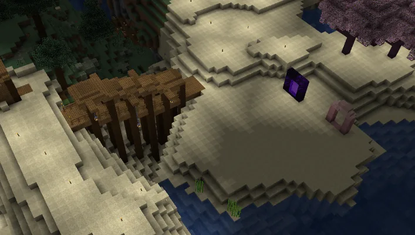
`https://raw.githubusercontent.com/Hanafubuki-minecraft/hanafubuki-brand/main/screenshots/web/10-map-spawn.webp`

### Карта: дом и мост
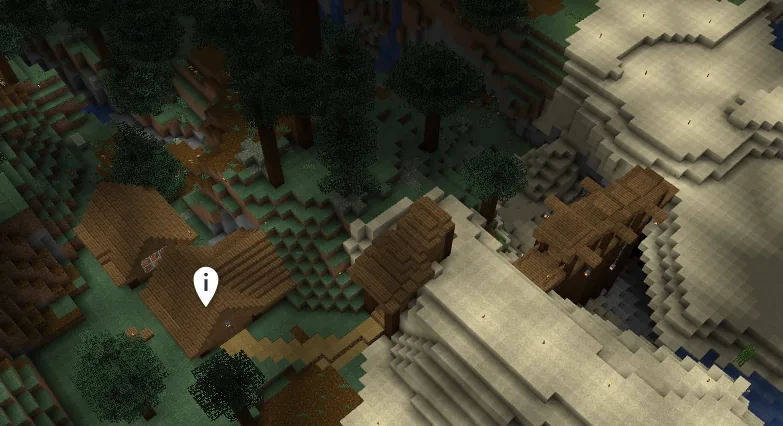
`https://raw.githubusercontent.com/Hanafubuki-minecraft/hanafubuki-brand/main/screenshots/web/11-map-village.webp`
